# re:parteé

**A pixel-art DJ adventure game.** From broke-ass bedroom DJ to festival headliner. One bad decision at a time.

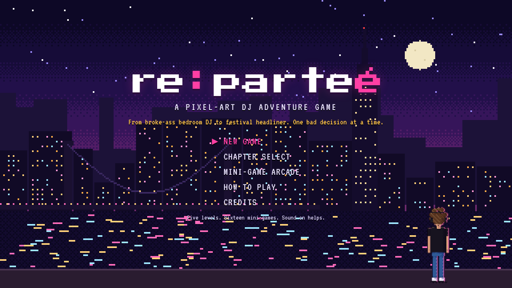

A point-and-click adventure in the spirit of *Maniac Mansion*, *Zak McKracken* and *The Secret of
Monkey Island*. You're a broke bedroom DJ in New York City with four records, a crackling mixer
and a phone at 1%. Hustle, dig, mix and talk your way from Bushwick to a festival headline set.

- **Five levels:** Bedroom DJ → Underground Hustler → Club DJ → Touring DJ → Superstar DJ
- **Sixteen mini-games:** beat.Match, crowd.Read, set.Time, playlist.Order, go.Digging, crate.Digging,
  record.Hunt, buy.Gear, mak.Tracks, get.Followers, promoter.Talk, guest.List, sound.Check,
  after.Party, club.Drama, last.Train
- **Real music culture:** a catalog of real records, labels and DJ gear (Pioneer CDJs, Technics
  SL-1210s, KRK and Dynaudio monitors, the Can Electric Taula 4 MR rotary mixer), with release
  details checked against Discogs and Wikipedia.
- **Everything is code:** all art is drawn procedurally in 1990s VGA style (hue-shifted ramps, Bayer
  dithering, banded light maps, shaded characters with rim light and cast shadows) and all sound is
  synthesized live with the Web Audio API. The game ships no image or audio files.

## Play

**In the browser:**

- [**Level 1: Bedroom DJ**](https://claude.ai/artifact/RPmqCfmHeBj3b1uwsdSdbN): Tuesday night in
  Bushwick to your first gig at Nowhere on Saturday, plus all sixteen mini-games in the arcade. Its
  ending links to the full game.
- [**The full game**](https://claude.ai/artifact/8tvKcJw3WLVhBsno8Snk6N), all five levels.

**Offline:** open `dist/index.html` (full game) or `dist/level1.html` (Level 1) in a browser. Each is a
single self-contained file that works from `file://` or hosted anywhere. On a phone, landscape gives
the full screen; portrait puts the controls under the scene.

Controls: pick a verb, then click something. Click the floor to walk. Right-click looks.
**H** or **Tab** labels everything clickable. **MENU** opens messages, the subway map, your
record crate, your setup and saving. Mini-games explain their own controls and can be replayed
from the title screen's Mini-Game Arcade. Chapter Select jumps to any level.

## Screenshots

| | |
|---|---|
| 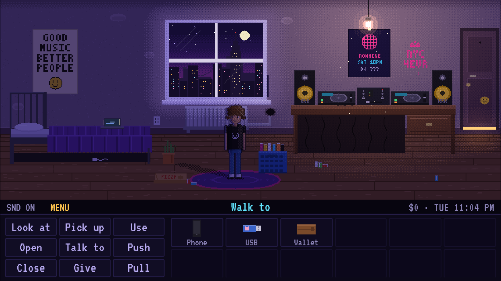 **Level 1, Bedroom DJ.** Apartment 4C, Tuesday 11 PM. A crackling mixer, a neighbor who bangs on the pipe, a phone at 1%. | 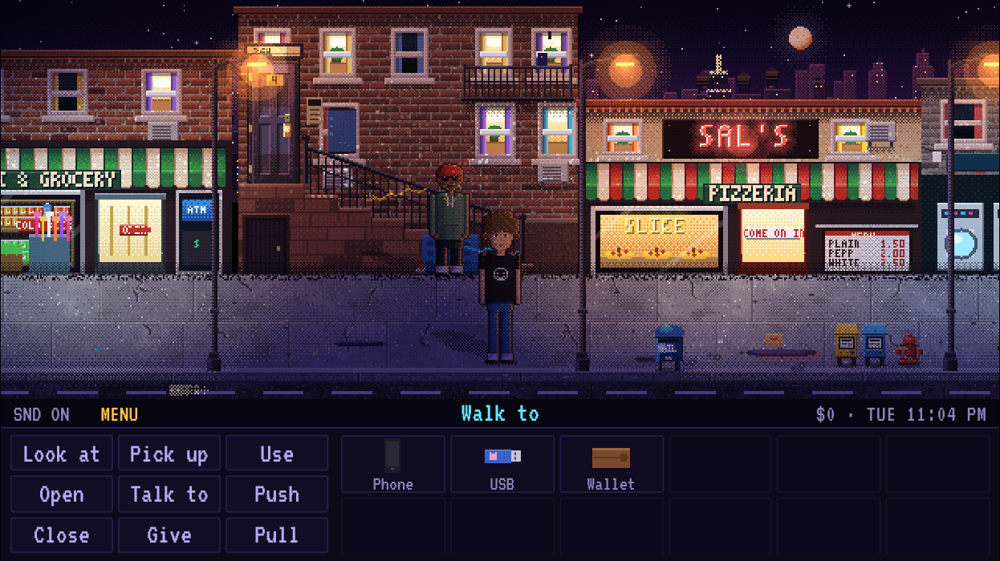 **Level 1.** The stoop, the bodega and Sal's. Smitty has a "package" for you. |
| 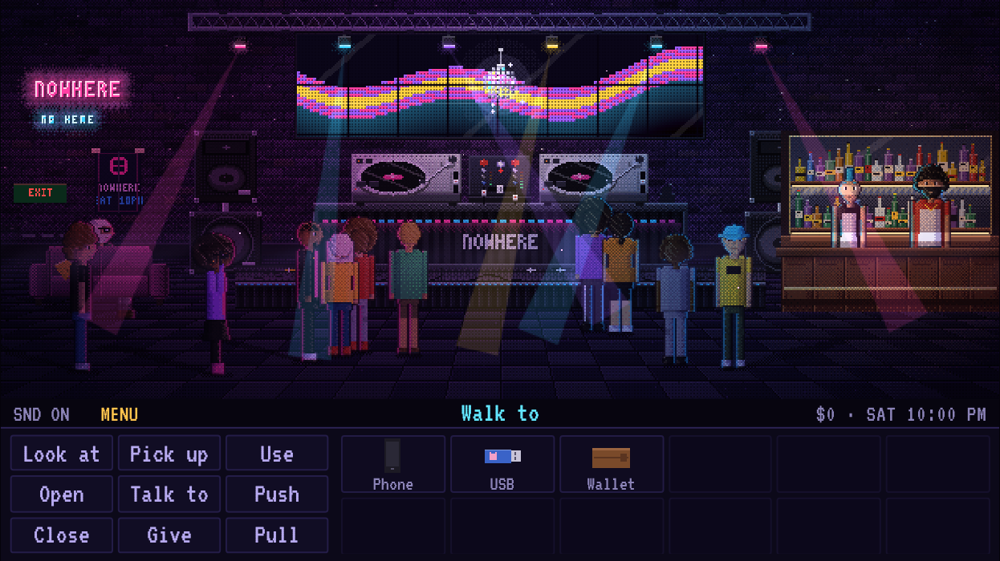 **Level 1.** Saturday at Nowhere: your first gig, and the bartenders are the crowd. | 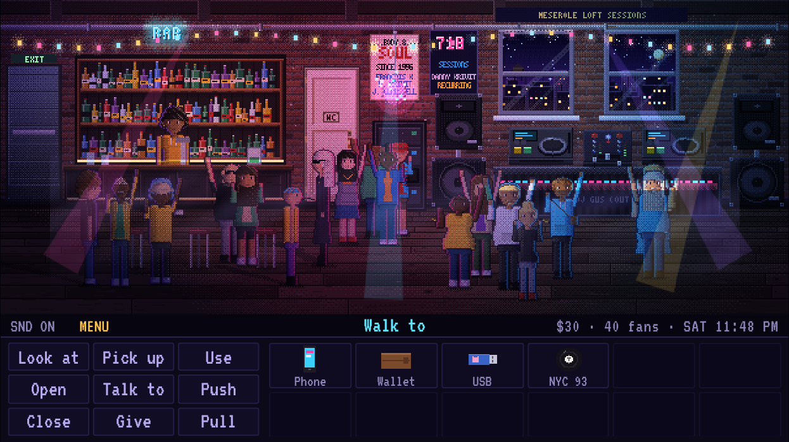 **Level 2, Underground Hustler.** A Meserole St loft party, once you've fixed the dead PA. |
| 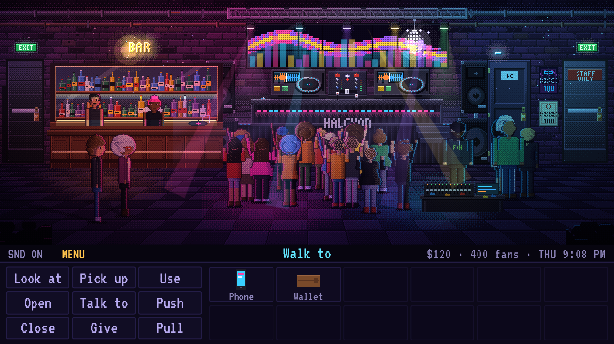 **Level 3, Club DJ.** Thursday residency at the Halcyon Room. | 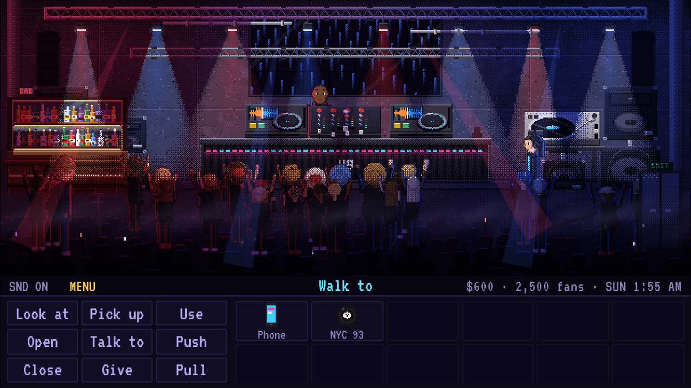 **Level 4, Touring DJ.** A flight to Berlin and a 2 AM handover at Halle Neun, a concrete techno hall. |
| 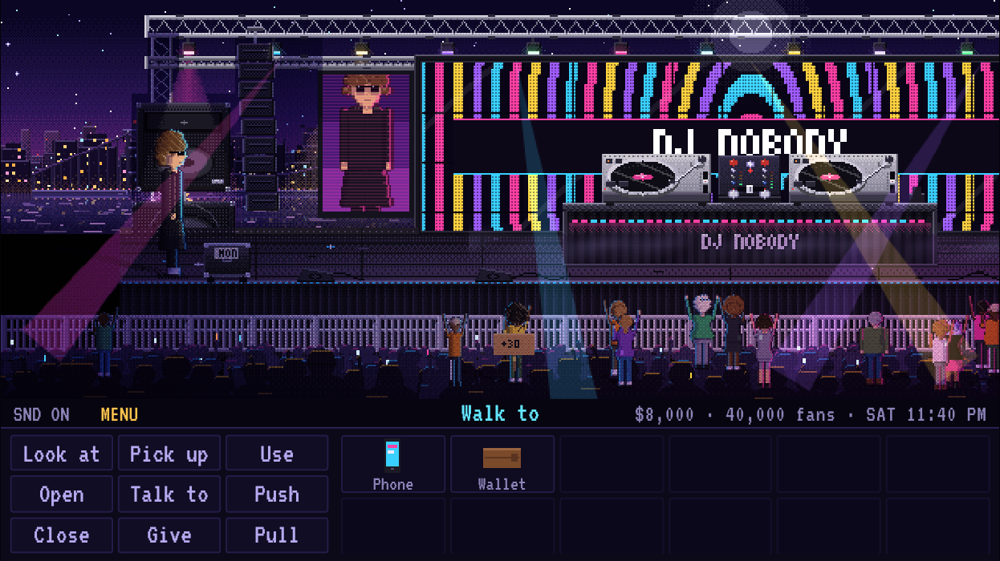 **Level 5, Superstar DJ.** Headlining Harbor Lights, after the main act overruns. | 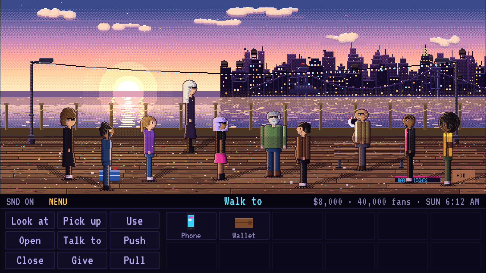 **Level 5.** Sunrise on the pier, with everyone who got you there. |

Mini-games:

| | |
|---|---|
| 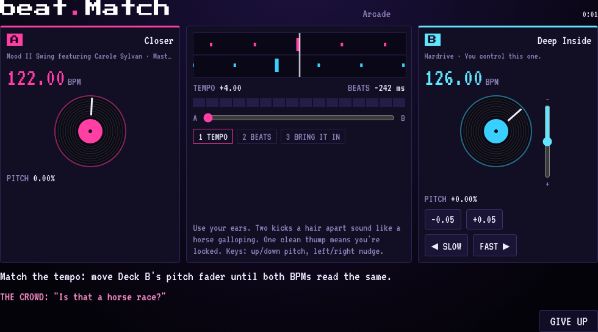 **beat.Match.** Ride the pitch fader and nudge the platter until the kicks lock. | 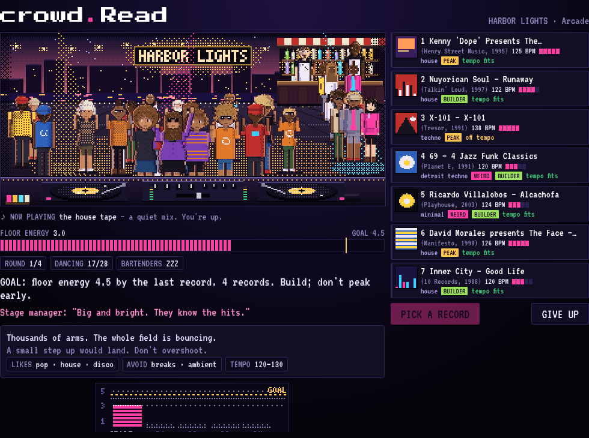 **crowd.Read.** Pick the next record for the floor you've got, not the one you want. |
| 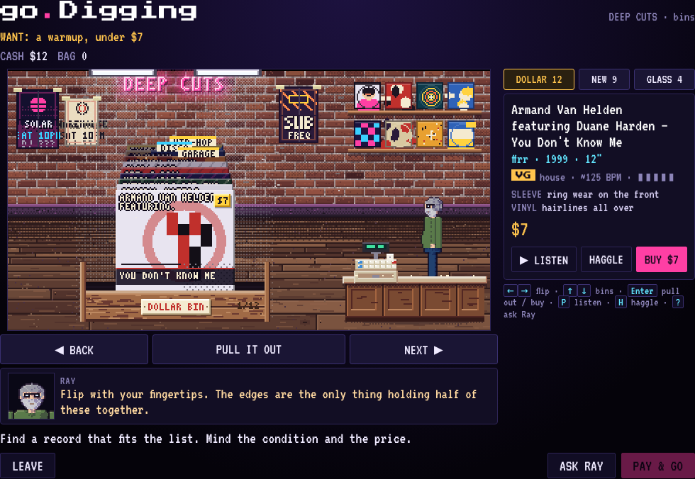 **go.Digging.** Flip the bins, check the vinyl for warps, haggle with Ray. | 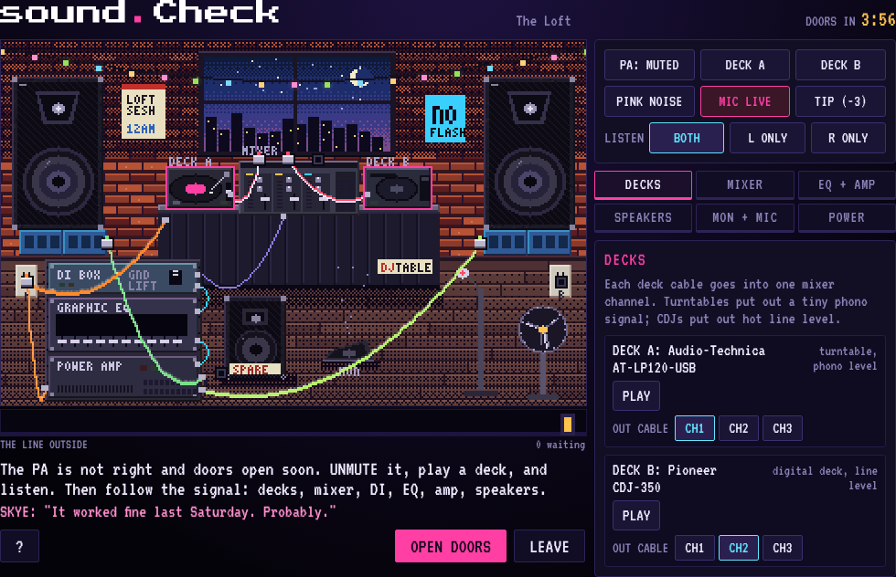 **sound.Check.** Doors open in four minutes and the PA hums. Follow the signal chain. |

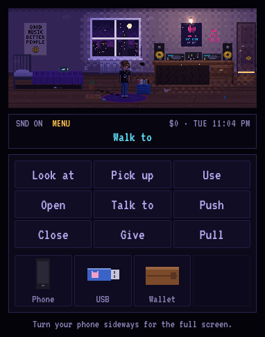

On a portrait phone the verbs and inventory drop under the scene at touch size.

## Develop

```
node tools/build.mjs                 # index.html (dev, one <script> per file), dist/index.html + dist/artifact.html (full game),
                                     # dist/level1.html + dist/level1.artifact.html (Level 1 on its own)
node tests/full.mjs                  # plays every level's walkthrough, then the whole game in one save
node tests/run.mjs smoke             # boots every level and lists the mini-games
node tests/perf.mjs                  # frame cost of every room (budget 8 ms)
node tests/run.mjs walk act2 --act 2 # one level's walkthrough
node tests/run.mjs shot a2_couch out.png --act 2
node tests/run.mjs mg crowdRead out.png
node tools/screens.mjs               # regenerates the screenshots in docs/screenshots/
```

### Deploy to Vercel

The repo includes a `vercel.json`: Vercel runs `node tools/build.mjs` (no dependencies to install) and
serves `dist/`, so `/` is the full game and `/level1` is Level 1 on its own. Import the GitHub repo at
vercel.com (framework preset "Other"; the settings come from `vercel.json`) or run `npx vercel` in the
repo root. Pushes to the production branch (`main` by default) update the live site; other branches
get preview URLs.

Docs for contributors: [`docs/ENGINE_API.md`](docs/ENGINE_API.md), [`docs/STORY.md`](docs/STORY.md),
[`docs/STYLE.md`](docs/STYLE.md), [`docs/MINIGAMES.md`](docs/MINIGAMES.md), [`docs/PAINTKIT.md`](docs/PAINTKIT.md),
research notes in [`docs/research/`](docs/research/).

Layout: `src/core` (engine, characters, lighting/FX, audio, paint kit), `src/data` (records, gear,
lore, recurring cast), `src/minigames`, `src/acts/act1..act5`, `src/game.js` (title, menus, credits).

## A note on real people and places

Records, labels, artists, DJs, gear and historic venues are real and referenced as homage. BPMs
are approximate and in-game prices are game values, not market prices. Appearances and dialogue
by real DJs are brief, fictional cameos and imply no endorsement. Every other character, club,
store and company in the story is fictional.
